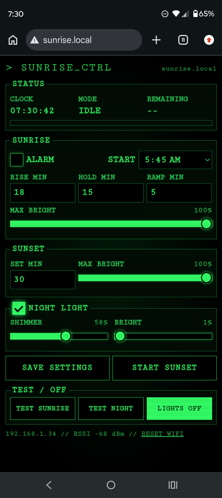

# SUNRISE_CTRL

A customizable sunrise, sunset and night light using an addressable LED light strip, with a retro green-screen web GUI for setting them.

ESP8266 (NodeMCU v2) driving a 144 px WS2815 or WS2812 strip.

## Features

- **First boot:** with no saved credentials, it opens an access point called `Sunrise-Setup` with a captive portal (WiFiManager). Pick your network there and it's remembered.
- **Control page:** lives at http://sunrise.local (mDNS). The IP address is shown on the page too.
- **Time:** from NTP, US Central with DST.
- **Night light:** after a sunset, a dim purple shimmer with the odd red or green sparkle runs until the alarm START time. See [Night light](#night-light).
- **OTA updates:** with the PlatformIO env `nodemcuv2_ota`, or in a browser at http://sunrise.local/update (user `admin`, password `OTA_PASSWORD`). Upload `.pio/build/nodemcuv2/firmware.bin` there.
- **LED data:** GPIO3 (the pin marked RX). The I2S DMA engine sends the bits, so WiFi interrupts can't corrupt the timing and the CPU isn't blocked while a frame goes out. GPIO3 is not a boot strapping pin, so the strip can't stop the board from booting. `Serial` is TX only: log output still works, serial input doesn't. To go back to the old D4 (GPIO2) wiring, set `LED_DATA_GPIO` to 2 in `src/main.cpp`.

## Control Page




## Power

Works with a variety of light strips supported by NeoPixelBus.

- **5V strips (WS2812 and similar):** give the strip its own power feed from your 5V supply. Don't run high current through your dev board.
- **12V strips (WS2815 and similar):** tie all grounds together.
- **Calculate your amp draw:** a 144 px WS2815 draws nearly 2A at 100% at the end of sunrise. A 144 px WS2812 draws over 8A.
- **Size your power supply** with those numbers in mind. Don't run the supply at full load.
- **Heat:** mounting the strip to an aluminum channel or plate can prolong its life.

## Parts list

| Part | 12V build (WS2815) | 5V build (WS2812) |
|---|---|---|
| Controller | NodeMCU v2 (ESP-12E, CP2102) | Same |
| LED strip | WS2815, 144 px | WS2812B, 144 px |
| Power supply | 12V, 3A or more | 5V, 10A or more |
| Buck converter | 12V to 5V, 1A or more | Not needed |
| Level shifter | 74AHCT125 (or 74HCT125) | Same |
| Series resistor | 330 ohm, 1/4 W | Same |
| Bulk capacitor | 1000 uF, 25V or higher | 1000 uF, 10V or higher |
| Fuse | Inline blade fuse, 3A | Inline blade fuse, 10A |
| Power wire | 18 AWG | 16 AWG, inject power at both ends |
| Optional | Aluminum channel for heat | Same |

## Interconnects

### Power

| From | To | Notes |
|---|---|---|
| Supply + | Fuse, then strip V+ | 12V or 5V, matching the strip |
| Supply - | Strip GND | |
| 1000 uF capacitor | Across strip V+ and GND | At the strip input, observe polarity |
| Supply + (after fuse) | Buck converter IN+ | 12V build only |
| Supply - | Buck converter IN- | 12V build only |
| Buck 5V OUT (or 5V supply) | NodeMCU Vin | |
| Buck 5V OUT (or 5V supply) | 74AHCT125 VCC (pin 14) | |
| Common ground | NodeMCU GND, 74AHCT125 GND (pin 7) | All grounds tie together |

### Data

| From | To | Notes |
|---|---|---|
| NodeMCU RX (GPIO3) | 74AHCT125 1A (pin 2) | Was D4 (GPIO2) before the boot fix. Leave D4 unconnected |
| 74AHCT125 1OE (pin 1) | GND | Enables channel 1 |
| 74AHCT125 1Y (pin 3) | 330 ohm resistor, then strip DI | Resistor close to the strip |
| 74AHCT125 2OE, 3OE, 4OE (pins 4, 10, 13) | 5V | Disables unused channels |
| 74AHCT125 unused inputs (pins 5, 9, 12) | GND | Keeps them from floating |
| Strip BI (first pixel) | GND | WS2815 only |

```text
NodeMCU RX (GPIO3) ---> [74AHCT125 1A -> 1Y] ---[330 ohm]---> strip DI
```

Also fit these two, both at the NodeMCU:

| Part | Where | Why |
|---|---|---|
| 470 uF electrolytic + 0.1 uF ceramic | Across Vin and GND | Holds the board's 5V up while the strip's inrush pulls on the shared supply |
| 1 uF ceramic | From EN to GND | Holds the ESP8266 in reset until its 3.3V rail has finished rising |

## Why each part is there

- **Level shifter:** the ESP8266 drives 3.3V logic. A WS2812 wants about 0.7 x VDD, roughly 3.5V, to read a high, so 3.3V sits right on the edge. It often works on the bench, then glitches when the supply sags or the wire gets longer. The 74AHCT125 reads 3.3V as a clean high and drives a full 5V edge.
- **Level shifter, second reason:** it isolates the ESP8266 pin from the strip. A strip input that is unpowered, or still powering up, can drag a pin wired straight to it toward ground. On GPIO2 (the old data pin) that stops the boot, because GPIO2 is a strapping pin and has to be high at reset. The firmware now uses GPIO3, which isn't a strapping pin, but keep the shifter: it also fixes the 3.3V level. Power it from the same 5V as the NodeMCU so it is never unpowered while the ESP is running.
- **330 ohm resistor:** dampens ringing on the data edge and limits current into the first pixel's input if the strip and board power up at different times. Put it close to the strip's DI.
- **1000 uF capacitor:** absorbs the inrush when the supply first connects, which can kill the first pixel. Mount it across V+ and GND at the strip input and observe polarity.
- **Buck converter (12V build):** the NodeMCU's onboard regulator is linear. From 12V it burns about 0.7W as heat under WiFi load and runs hot. A small buck to 5V into Vin avoids that and also powers the level shifter.
- **Fuse:** a 5V 144 px strip at full white can pull 8A or more. Fuse at the supply, sized just above the strip's real draw.

## WS2815 notes

- WS2815 strips have a backup data line (BI) next to DI. On the first pixel, tie BI to GND. Leaving it floating can cause flicker.
- At 12V the voltage drop along 144 px is small, so power injection at one end is usually enough. At 5V it is not: feed V+ and GND at both ends of the strip, or the far end will drift toward red at high brightness.

## Grounding

Every ground ties together: power supply, strip, buck converter, NodeMCU and level shifter. Data has no reference without a shared ground, and a missing ground is the most common reason a strip shows random colors.

## If it won't come up after a power cycle

The first few pixels lit in random colours after power-on mean `setup()` never ran, because the first thing it does is blank the strip. Look at the boot log: connect a 3.3V USB-serial adapter's GND and RX (only those two wires) to the NodeMCU's GND and TX, open a terminal at 74880 baud, and power-cycle the whole build from its supply.

- `boot mode:(3,x)` is a normal flash boot. If it then hangs, look at power.
- `boot mode:(2,x)` or `(0,x)` means GPIO2 was low at reset. Something on D4 is dragging it down.
- `boot mode:(1,x)` means GPIO0 (D3) was low at reset.
- Nothing at all, or garbage, means the chip didn't start cleanly: check the 3.3V rail and EN while powering up.

## Night light

About every 2nd to 3rd pixel is lit (every 3rd at BRIGHT 1%, every 2nd at 100%). Each lit spot, a "glint", wanders around its slot and dims and brightens, and the whole pattern creeps slowly along the strip, so the spacing is never a fixed pattern.

- **SHIMMER (0-100%)** sets how fast the glints wander, how deep they dim and how often a sparkle appears: none at 0%, about one every 7 s at 40%, about one every 3 s at 100%. At 0% the pattern stands still.
- **BRIGHT (1-100%)** sets the counts per glint on a 2.2 curve. A lit pixel is never dimmer than (1,0,2) in R,G,B, because at one or two counts a scaled purple loses its red and turns pure blue. Below that floor, the light gets dimmer by lighting fewer pixels. At 1%, only about a quarter of the glints show at (1,0,2).
- **Purple mix:** `NL_RED_PER_BLUE` (0.33) in `src/main.cpp`. Raise it if it looks too blue, lower it if it looks too pink. The floor is `NL_FLOOR_R` and `NL_FLOOR_B`.
- The sliders act on the strip right away while the night light or its test is showing. Press **SAVE SETTINGS** to keep them.

**When it runs**

- It starts when a sunset finishes and the NIGHT LIGHT box is ticked. It fades in over a couple of seconds from black. Ticking NIGHT LIGHT and saving while the strip is idle (sunset already done) starts it right away, running until the next START time.
- **Alarm on:** the sunrise starts at START, and the night light fades out over the first 30 s of the sunrise.
- **Alarm off:** it fades out over 60 s at the START time anyway.
- **No sunset, no night light (unless enabled).** If NIGHT LIGHT is ticked and saved while the strip is idle after sunset, it starts at once and runs until the next START time. Otherwise use TEST NIGHT or START SUNSET to see it.
- **LIGHTS OFF:** off at once, and it stays off until the next sunset. The alarm still runs.
- **Untick NIGHT LIGHT and SAVE** while it's on: it fades out in 2 s.
- **START SUNSET or TEST SUNRISE** while it's on: it cuts out at once. A new night light starts after the new sunset.
- **TEST NIGHT:** starts it at once, works even with the box unticked, and turns itself off after 10 minutes. The button reads STOP TEST while it runs. It doesn't interrupt a real night light.
- **No clock** (NTP never synced): it runs for at most 12 hours.
- **Power cut in the night:** the end time is saved to flash once when the night light starts. After a reboot, once the clock has synced, it comes back on if that end time hasn't passed and still matches the START time.

`/api/state` also reports `frameUs`: the worst render plus `Show()` time in the last second, in microseconds. Frames are 33 ms apart.

## Before first power-on

1. Copy `secrets.ini.example` to `secrets.ini` and set `ota_password` there. `platformio.ini` passes it to the firmware and to the OTA upload, so the two always match. `secrets.ini` is gitignored. The build prints a warning while the password is still `changeme`.
2. Set `TZ_STRING` in `src/main.cpp` if you are not in US Central time.
3. Check `NUM_LEDS` against your strip.
4. If red and green come out swapped, change `NeoRgbFeature` to `NeoGrbFeature`.
5. Power the strip from the supply, never through the NodeMCU's USB or 5V pin.
6. Flash over USB first with the `nodemcuv2` env. After that, use `nodemcuv2_ota`.

## Acknowledgments

Firmware design, code review and documentation were developed with Maya, an AI agent by Sesame.
